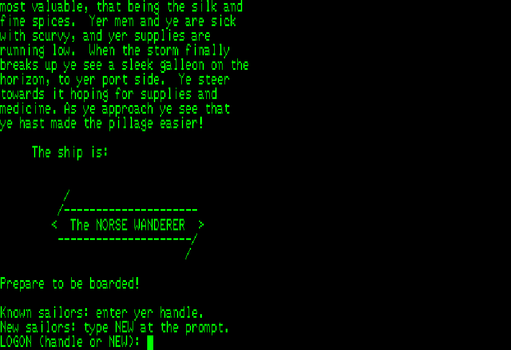

# Uthernet2

An emulation of the a2RetroSystems Uthernet II, an Ethernet card for the
Apple II built around the WIZnet W5100, as a plug-in card for
[ReplicApple2Plus](https://github.com/sbabcoc/ReplicApple2Plus) (short
name `uthernet2`).

The W5100 is modeled at its register interface, after its datasheet, and
the card after its manual and schematic: the chip's /INT drives the
Apple's /IRQ, and the Apple's RESET resets the chip. See
[HARDWARE-REFERENCE.md](HARDWARE-REFERENCE.md), which tags each claim with
its evidence. The card plugs into a private virtual network that reaches
the Internet through the host's own sockets: no privileges, native
libraries or host setup, and the same behavior on macOS, Windows and
Linux, PRoot included.

## The virtual network

| Address | What it is |
|---|---|
| 10.0.2.15 | The Apple, as leased by DHCP |
| 10.0.2.2 | The gateway, and DHCP server; connecting to it reaches the host itself |
| 10.0.2.3 | The name server; it answers with the host's own resolver |
| 255.255.255.0 | The netmask |

These are the addresses QEMU's user-mode networking uses. Software that
runs DHCP (IP65, Contiki, Marinetti) needs no settings. Any other address
is passed to the host as is, so a hand-configured Apple can also reach
machines on the host's real LAN.

How the guest reaches the network depends on the socket mode it uses:

- **TCP and UDP mode** use the W5100's own TCP/IP stack, which the card
  carries straight onto host sockets. A socket in LISTEN binds the same
  port on the host.
- **MACRAW mode** (IP65, Contiki) puts Ethernet frames on the virtual
  LAN. The gateway answers ARP, DHCP, DNS and pings to its own addresses,
  and carries UDP and TCP to the host.
- **IPRAW mode** sends IP packets onto the same LAN; only ICMP echo to the
  gateway's own addresses gets an answer.

## The utility disks

Two programs for the Apple II+ that use the card, on two 140K disk images
in `src/apple/disks/`: `uthernet2-dos33.dsk` for DOS 3.3 and
`uthernet2-prodos.po` for ProDOS. Neither image carries an operating
system: boot your own DOS 3.3 or ProDOS disk, then `BRUN TELNET` or
`BRUN GOPHER` from the utility disk (ProDOS needs BASIC.SYSTEM), or copy
them onto your boot disk.

- **TELNET** connects to telnet BBSes. It answers a BBS's telnet options
  (terminal type VT100, window size 80x24) and shows its ANSI screens.
  With a Saturn card, it keeps the last 1,024 lines to scroll off the top.
- **GOPHER** browses Gopher servers: menus, text documents and searches.
  Menus and text both stream a page at a time, so any size can be read.
  With a Saturn card, paging back redraws from the card instead of
  fetching again.

Both find the card in any slot and get an address over DHCP. Both use a
Saturn 128K card in slot 0, in place of the Language Card
(`type=saturn128` in `[0]`), when there is one: its banks 2-8; bank 1 is
the Language Card memory ProDOS or DOS 3.3 uses, and is left alone.
Neither needs one. Both draw an 80-column screen: on the VideoTerm when
slot 3 holds one (firmware 2.4 requires slot 3, so the Uthernet II then
goes elsewhere), otherwise as "Soft-70" text on the Hi-Res screen, which
shows 70 of the 80 columns at a time. With the shift-key mod on
pushbutton 2, letters typed without Shift are lowercase.

[UTILITIES.md](UTILITIES.md) describes both programs in full, with
screenshots: connecting, every key, the scrollback, Gopher addresses,
and how menus and documents are paged.

## Installing

The card is a plug-in jar, `Uthernet2-<version>.jar`, from this project's
GitHub releases or Maven Central. Put it in a folder of plug-ins, and point
ReplicApple2Plus at that folder: with **File > Plugins Folder...**, or
`--plugins DIR` on its command line. Then add the card to a slot
configuration as `type=uthernet2`. It has no settings. IP65-based software
looks for it in slot 3 by default.

## Layout

| Package | Contents |
|---|---|
| `com.nordstrom.uthernet.w5100` | The W5100: registers, indirect bus interface, sockets. No Apple II or host dependencies |
| `com.nordstrom.uthernet.net` | The virtual network: host sockets, the gateway, DHCP and DNS |
| `com.nordstrom.uthernet.slot` | The ReplicApple2Plus plug-in card |
| `src/apple` | The utilities' 6502 source, their Makefile, and the disk images |
| `docs/images` | The screenshots in UTILITIES.md and this README |

## Building

ReplicApple2Plus must be in the local Maven repository (`./gradlew install`
in that project), at the version named in `gradle.properties`.

    ./gradlew build

The utilities and their disk images are checked in, so that needs nothing
else. Rebuilding them takes cc65, an IP65 checkout and AppleCommander; see
`src/apple/Makefile`. `./gradlew screenshots -Proms=DIR` captures the
screenshots in `docs/images` again, from the programs in
`src/test/resources`, on the VideoTerm's 80-column screen. It connects to
The Norse Wanderer BBS and `gopher.floodgap.com`, so it needs Internet
access, and reads the VideoTerm's two ROM images from `DIR` -- the same
files, by the same names, as ReplicApple2Plus's ROM folder holds.

## Verification

- `W5100Test` drives the chip through its four bus addresses against a
  scripted network: direct and indirect bus modes, reset values,
  auto-increment and its wraps, software and hardware reset, buffer
  allocation, and each socket mode.
- `GatewayTest` plays a MACRAW guest with hand-built frames against real
  servers on the host's loopback: ARP, DHCP, DNS, ping, UDP, and TCP
  connection, transfer, close, retransmission and reset.
- `Uthernet2Test` drives the card through its I/O switches: the manual's
  own installation test and slot probe, /IRQ and RESET, and sockets in
  TCP and UDP mode reaching real host servers, including LISTEN.
- `TelnetTest` and `GopherTest` run the utilities' own binaries on the
  6502, against a scripted BBS and a Gopher server on the host's loopback:
  telnet negotiation, the ANSI screen, the cursor report, lowercase input,
  menus, paging, search, and both screens. The VideoTerm side runs against
  `VideoTermDouble`, a stand-in written from ReplicApple2Plus's hardware
  reference, since the real card model needs Videx's ROMs.
- `Ip65Test` runs IP65's own Uthernet II driver and TCP/IP stack on
  ReplicApple2Plus's 6502, paced to real time: it leases an address,
  looks up `localhost`, and echoes a line over TCP. The 6502 program is
  `src/test/asm/ip65test.s`; `src/test/asm/Makefile` rebuilds it.
