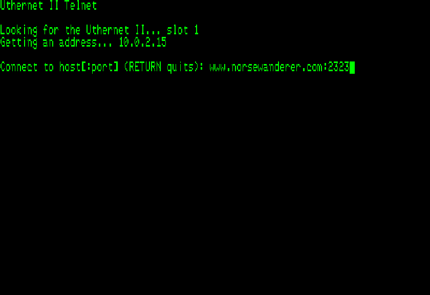
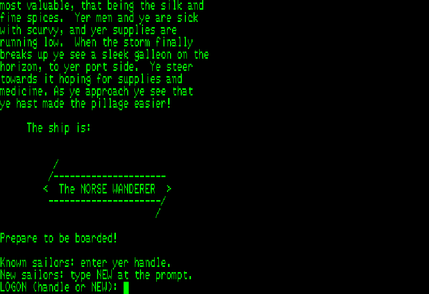
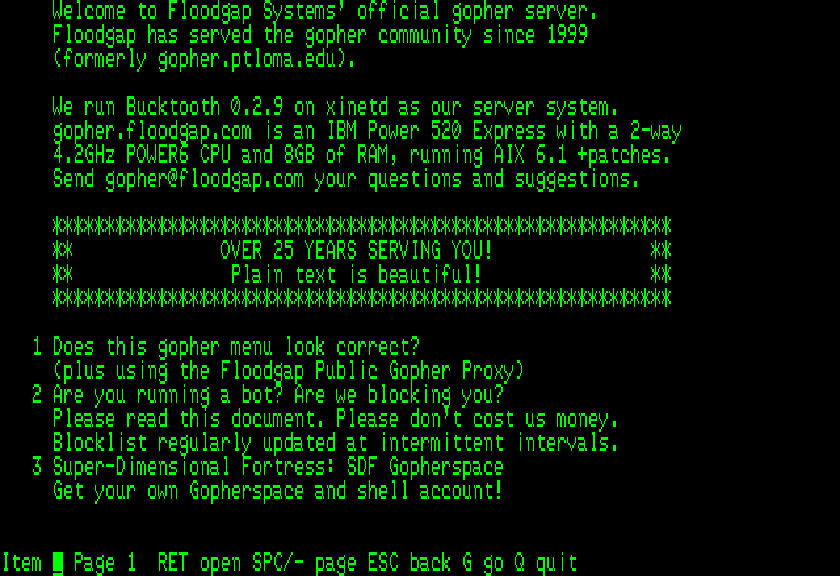
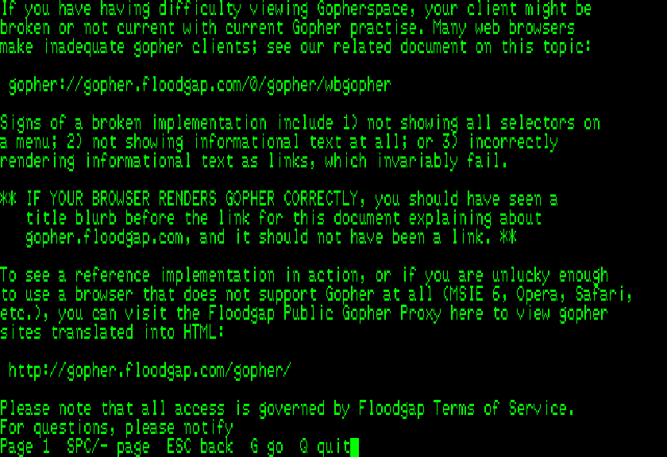
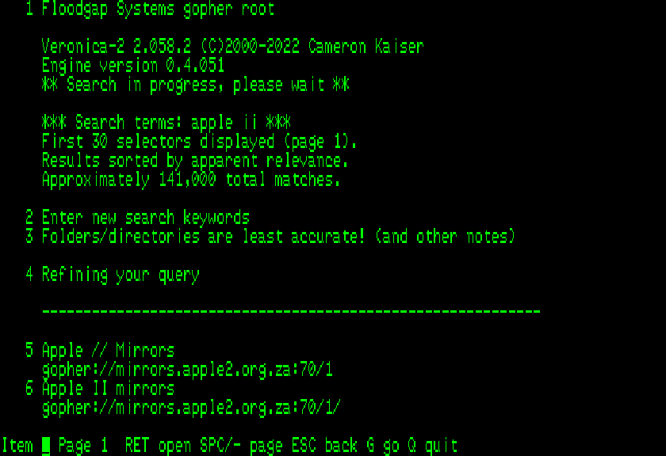

# The Utility Disks

Two programs for the Apple II+ that use the Uthernet II: **TELNET**, a
terminal for telnet BBSes, and **GOPHER**, a Gopher client. They come on
two 140K disk images in `src/apple/disks/`, and are attached to each
GitHub release:

| Disk | For |
|---|---|
| `uthernet2-dos33.dsk` | DOS 3.3 |
| `uthernet2-prodos.po` | ProDOS (with BASIC.SYSTEM) |

The screenshots here are of the VideoTerm's 80-column screen (see
[The screen](#the-screen)), drawn as ReplicApple2Plus draws it. TELNET is connected to
[The Norse Wanderer](https://norsewanderer.com), an Apple II BBS from
the 1980s, back online (`www.norsewanderer.com`, port 2323); GOPHER to
Floodgap's Gopher server, `gopher.floodgap.com`.

## Running them

Neither image carries an operating system. Boot your own DOS 3.3 or
ProDOS disk, put the utility disk in a drive, and `BRUN TELNET` or
`BRUN GOPHER` -- or copy them onto your boot disk. Both programs end by
returning to BASIC.

The slot configuration needs the Uthernet II (`type=uthernet2`) in any
slot. Two other cards are used when present:

- **A Saturn 128K card in slot 0**, in place of the Language Card
  (`type=saturn128` in `[0]`). The programs use its banks 2-8, 84K; bank 1
  is the Language Card memory ProDOS or DOS 3.3 uses, and is left alone.
  TELNET keeps a scrollback there, and GOPHER keeps what it reads, so
  paging back doesn't fetch it again. Without one, both work fully, less
  those two features.
- **A VideoTerm in slot 3** gives a true 80-column screen. Its firmware
  2.4 requires slot 3, so the Uthernet II then goes in another slot.

On starting, each program looks for the card -- slots 3, 4, 2, 1, 5, 6
and 7, in that order, the Uthernet II manual's order, skipping slot 3
when the VideoTerm holds it -- then gets an address from the virtual
network's DHCP server. If either step fails, it says so and returns to
BASIC at a key press.



## The screen

Both programs draw an 80-column, 24-line screen:

- **On the VideoTerm**, when slot 3 holds one: all 80 columns at once.
- **Otherwise as "Soft-70" text** on the Hi-Res screen, which shows 70
  of the 80 columns at a time. The left and right arrows show the left
  or right 70 (in TELNET, after ESC). Everything is still laid out in
  80 columns -- a BBS is told the window is 80x24 -- so nothing is
  rewrapped; the columns out of view are a key press away.

The II+ keyboard types capitals only. With ReplicApple2Plus's shift-key
mod on pushbutton 2, letters typed without Shift are lowercase. The II+
keyboard can't type `` [ \ _ { } | ~ `` or the backquote.

## TELNET

TELNET connects to a telnet BBS and acts as its terminal.

### Connecting

At `Connect to host[:port]`, type a host name or address, with a port
after a colon if it isn't 23, then RETURN -- for The Norse Wanderer,
`www.norsewanderer.com:2323`. TELNET looks up the name with the
network's name server, connects, and says `connected. ESC Q disconnects.` If the name isn't found or the connection fails, it says
so and asks again. RETURN alone, or ESC, at the prompt quits.

### In a session

TELNET answers the telnet options a BBS asks about -- terminal type
VT100, window size 80x24, server echo, suppress go-ahead -- and refuses
the rest. It shows the BBS's ANSI screens: cursor movement and
positioning, erasing the screen and lines, saving and restoring the
cursor, and the cursor position report many BBSes use to detect an ANSI
terminal. Colors and other attributes are ignored, and PC box-drawing
and graphics characters print as their nearest ASCII: `+`, `-` and `|`
for the boxes.



Keys typed go to the BBS as they are, RETURN as a carriage return. ESC
starts a command:

| Keys | What they do |
|---|---|
| ESC Q | Disconnects, and returns to the host prompt |
| ESC ESC | Sends ESC to the BBS |
| ESC left arrow, ESC right arrow | Show the left or right 70 columns (Soft-70) |
| ESC - | Shows the scrollback (Saturn card) |

When the BBS hangs up, TELNET says `Connection closed.` and asks for the
next host.

### Scrollback

With a Saturn card, the last 1,024 lines to scroll off the top of the
screen are kept, and ESC then `-` shows them. The bottom line says how
far back the view is.

| Key | What it does |
|---|---|
| - | Goes back a page |
| SPACE | Comes forward a page |
| ESC or RETURN | Returns to the session |

## GOPHER

GOPHER browses Gopher servers: their menus, text documents and searches.

### Going somewhere

At the first prompt, and whenever G is pressed, GOPHER asks where to go:

```
[gopher://]host[:port][/type selector]
```

The port is 70 unless one is given; with no type and selector, GOPHER
opens the server's main menu. So `gopher.floodgap.com`,
`gopher.floodgap.com:70` and `gopher://gopher.floodgap.com/1` all open
Floodgap's main menu -- and so does RETURN alone. ESC at the first
prompt quits; at a later one, GOPHER goes back to where it was.

### Menus

Each item of a menu is numbered; information lines aren't. To open an
item on the page shown, type its number, then RETURN; the left arrow
erases a digit. Items are numbered through the whole menu, not page by
page, so the numbers on a later page carry on from the page before.



Items of type 0 (text), 1 (menu) and 7 (search) open. Other types --
binary files, pictures, web links -- are listed, but opening one says
`Can't open this type of item.`

### Text

A text document fills the screen a page at a time, 23 lines, with the
page number and the keys on the bottom line; `[end]` marks the last
page.



### Searches

Opening a search item asks `Search for:`; type the words and RETURN. The
server answers with a menu of what it found, which works like any other
menu.



### Keys

| Key | In a menu | In text |
|---|---|---|
| digits, RETURN | Open the item with that number | -- |
| SPACE | Next page | Next page |
| - | Previous page | Previous page |
| ESC | Back to where this was opened from | Back to where this was opened from |
| G | Go somewhere else | Go somewhere else |
| Q | Quit | Quit |
| left arrow, right arrow | Show the left or right 70 columns (Soft-70); the left arrow first erases a digit being typed | Show the left or right 70 columns (Soft-70) |

ESC goes back through the last six places visited, each at the page it
was left on.

### Menus and documents of any size

Menus and text both stream: each page is drawn as it arrives, and the
rest waits, unread, while the page is on screen, so a menu or document
of any length can be read. Leaving one partway closes the connection.

Paging back works the same either way, but differently underneath:

- **With a Saturn card**, everything read is kept there, so paging back
  redraws from the card. The card holds 84K of each menu or document;
  once a longer one has filled it, paging back fetches that one again,
  as without a card.
- **Without one**, paging back fetches the menu or document again and
  skips ahead to the page.
